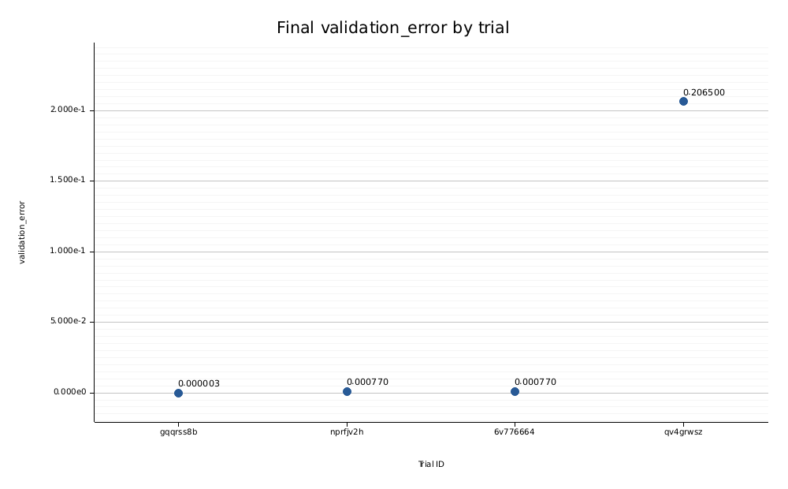

# RubixKube 0.2

A Rust command-line tool for hyperparameter optimization on Kubeflow Trainer. Configure your training image, parameters and objective; submit a typed OptimizationJob; resume monitoring; and export independently checked results as JSON, CSV and static graphs. No web app.

The built-in workload supports CPU/CUDA linear training on user CSV data. Other models and frameworks run through your own container image and the same metric-reporting contract.

## Install

Requires Rust 1.90.0 and `kubectl` on the client. An existing Kubernetes cluster must have compatible Kubeflow Trainer/OptimizationJob, JobSet and a suggestion provider installed. This release is tested against the revisions in `upstream.lock.json` on Kubernetes 1.37.

```text
cargo install --path . --locked --bin rubixkube
# Include optional NVIDIA CUDA execution in the built-in workload:
cargo install --path . --locked --features cuda --bin rubixkube
rubixkube --version
rubixkube completions powershell
```

General experiment commands work without this repository or the sibling upstream clones after installation. The separate local-cluster `start`/`run`/`smoke` development helpers still require the workspace layout described in [the demo guide](demo/README.md).

## Run an experiment

```text
rubixkube init --file experiment.json
# Edit the namespace, runtime, workload image, metric, parameters and resources.
rubixkube validate --config experiment.json
rubixkube doctor --config experiment.json --kubeconfig KUBECONFIG --context CONTEXT
rubixkube submit --config experiment.json --name my-fit --wait --kubeconfig KUBECONFIG --context CONTEXT --output runs/my-fit
```

Use an explicit kubeconfig and context for every cluster command. Config-based commands use the config's namespace; other commands default to `default` unless `--namespace` is supplied. An explicit namespace conflicting with the config is rejected.

```text
rubixkube status my-fit --namespace NAMESPACE --kubeconfig KUBECONFIG --context CONTEXT
rubixkube list --namespace NAMESPACE --kubeconfig KUBECONFIG --context CONTEXT
rubixkube logs my-fit --namespace NAMESPACE --kubeconfig KUBECONFIG --context CONTEXT
rubixkube watch my-fit --namespace NAMESPACE --kubeconfig KUBECONFIG --context CONTEXT --output runs/my-fit
rubixkube results my-fit --namespace NAMESPACE --kubeconfig KUBECONFIG --context CONTEXT --output runs/my-fit
rubixkube plot --report runs/my-fit/report.json
```

`submit` refuses duplicate job names. A watch timeout or interruption leaves Kubernetes work running; `watch` resumes without submitting more trials. Progress goes to stderr and command data to stdout as JSON. Completed results include the sampled parameters, objective ranking, raw resources, Pod logs and optional checked CUDA evidence.

```text
# Remove a managed run and its derived runtime, retaining the shared PVC:
rubixkube cancel my-fit --namespace NAMESPACE --kubeconfig KUBECONFIG --context CONTEXT
# Explicitly delete its retained shared data as well (also works after cancellation):
rubixkube cancel my-fit --purge-shared-data --namespace NAMESPACE --kubeconfig KUBECONFIG --context CONTEXT
```

Cancellation refuses foreign resources. RubixKube labels/config records are ownership safeguards, not a multi-tenant authorization boundary; use Kubernetes RBAC and trusted namespaces.

## Configuration and workloads

[Configuration reference](docs/configuration.md) · [Workload/metric contract](docs/workloads.md) · [Shared-data GPU example](examples/shared-gpu.json)

Supported searches are Random with categorical, uniform and log-uniform parameters, a configurable seed, 1–100 trials and configurable parallelism. Objectives support Minimize and Maximize. The pinned upstream controller does not implement Grid; floating log-uniform minima below `1e-10` are rejected because the pinned provider cannot preserve them.

A workload receives sampled values as `KUBEFLOW_TRAINER_OPT_<parameter>`. Report the final finite metric before the worker exits:

```text
rubixkube report --metric accuracy --value 0.94
```

This uses the controller-projected HTTPS endpoint, CA and bearer token. It requires exact HTTP 200 acknowledgement, validates TLS/hostname, disables redirects and never prints the token. You may also report through the upstream SDK or this crate's `metrics::deliver_metric` API. Use Secret references rather than inline credentials in experiment configuration.

## Shared initialization and GPU

An optional initializer runs once in a Kubernetes Job, writing a run-specific PVC. Only after it completes does RubixKube submit optimization trials with that PVC mounted read-only. Retry the same name/config after an interrupted initialization to reuse completed work; failed initialization prevents submission. PVC data is retained by default. Shared initialization currently requires a single-node runtime with a trainer container named `node` and permission to create the derived runtime and PVC.

The built-in trainer accepts `--dataset data.csv`, `--epochs N`, `--learning-rate R` and `--device cpu|cuda`. CSV has two finite numeric columns, `x,y`, with at least four rows; its first half trains and second half validates. `epochs` and `learning_rate` can also be supplied by optimization environment variables. CUDA computes all gradients, updates and validation on-device, synchronizes, and compares every result against CPU; failure never falls back to CPU.

[Local WSL GPU setup](demo/gpu/README.md) uses a dedicated cluster and your existing Windows GPU driver. For an existing Linux GPU cluster, choose its GPU-enabled runtime and worker image instead. The setup helper's WSL paths are not a general-purpose GPU operator.

## Executed acceptance

A real Kubernetes experiment used one initializer, a shared 256-row CSV for `y = 3x + 0.5`, two parameters (`learning_rate`, `epochs`), a custom `validation_error` objective and four actual RTX 5060 Ti training Pods. CPU/GPU numerical parity and final metrics were verified. Parallelism two on one GPU queued workers until the device was free; this is normal scheduling, not additional GPU capacity.

The earlier [GPU graphs](demo/results/gpu/) show the original fixed-dataset run. v0.2 acceptance evidence is saved outside Git; current example results are documented in the release notes. All graphs are static files.

## Build, checks and containers

```text
cargo fmt --check
cargo clippy --locked --all-targets --all-features -- -D warnings
cargo test --locked
cargo test --locked --all-features
cargo package --locked --allow-dirty --no-verify
```

Actual CUDA tests are opt-in and require a real GPU and NVRTC libraries; see the GPU guide. CI compiles CUDA support and runs hardware-independent tests, not GPU execution. Linux/WSL is the tested platform; native Windows/macOS operation is not certified by these checks.

The root Dockerfile builds non-root CPU/CUDA worker images (`--target cpu` or `--target cuda`). Those images provide training and metric-reporting commands; cluster lifecycle commands need an external `kubectl` executable. The source and generated binary include bundled-font notices; `rubixkube licenses` prints them. Cargo.lock, runtime images and the development toolchain are pinned. Cluster/driver availability and image-registry access remain deployment prerequisites.

## Release scope

This is a usable local single-node HPO tool, not a claim that the original 350-hour upstream project is production-complete. Upstream Trainer/JobSet/Optuna remain dependencies. Multi-tenant hardening, high availability, native multi-node/shared-volume topologies and controller/provider crash-recovery guarantees are outside v0.2. The Python Kubeflow SDK OptimizerClient backend was not rewritten; RubixKube submits the new CRD through its own typed configuration client.

Local reproducible workflow: [shared-data GPU quickstart](docs/quickstart.md).

## Packaged-worker result

The repository Dockerfile's packaged CUDA worker also completed four real trials with a shared initializer, custom CSV, searched epoch counts and the custom objective. The recorded results are available as [CSV](examples/results/shared-gpu/results.csv) and a [run summary](examples/results/shared-gpu/summary.txt).


