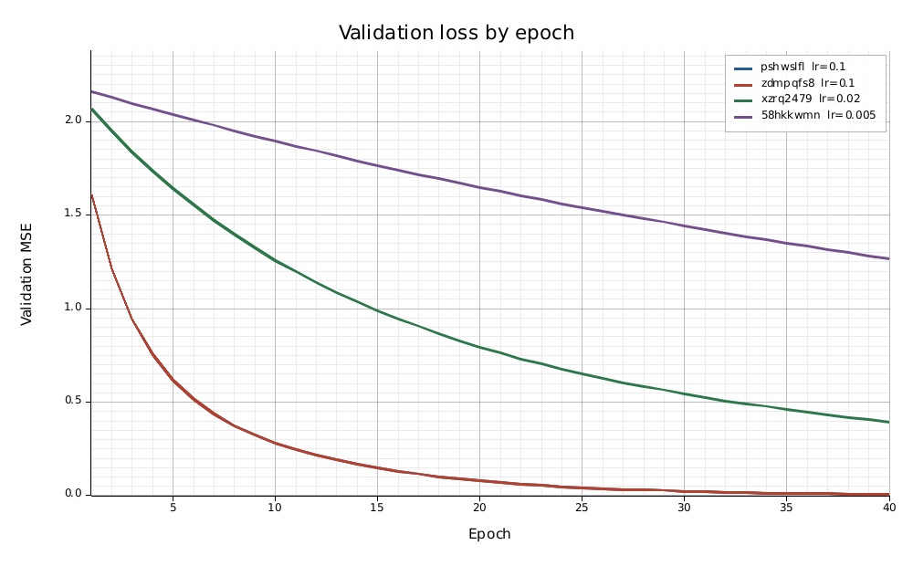
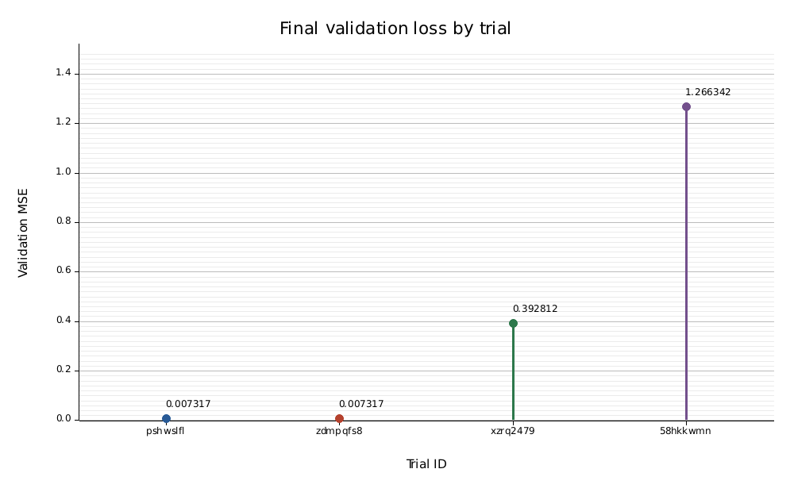

# OptimizationJob — Rust integration demo

This repository contains Rust training, authenticated metric delivery, Kubernetes demo orchestration, baseline tooling, report validation and tests. Upstream Kubeflow Trainer, SDK and Katib remain unchanged sibling dependencies pinned in `upstream.lock.json`.

The CPU or optional CUDA GPU demo submits a real `trainer.kubeflow.org/v1alpha1` OptimizationJob. Four actual training Pods fit a linear model and report held-out loss. The upstream controller and Optuna choose the trials and winner. See [demo/README.md](demo/README.md) for the full walkthrough.

## Source map

| File | Responsibility |
|---|---|
| `src/main.rs` | CLI: `train`, `run`, `start`, `smoke`, `plot` |
| `src/training.rs` | Deterministic CPU model fitting and validation history |
| `src/gpu.rs` | Actual CUDA training, device timing and CPU parity verification |
| `src/gpu_cluster.rs` | Dedicated WSL GPU Kubernetes cluster setup |
| `src/metrics.rs` | HTTPS metric push with projected CA and bearer token |
| `src/process.rs` | Bounded external commands, source cleanliness/revision checks |
| `src/report.rs` | Independent objective ranking and winner validation |
| `src/orchestrate.rs` | Cluster installation, submission, evidence collection, baseline |
| `src/plots.rs` | Standalone PNG/SVG graphs, CSV and text results |
| `tests/*.rs` | Training parity, reports, TLS, Git guards, process deadlines, CLI and plot exports |
| `demo/fixtures/` | Original dataset and pre-migration Python numerical references |

Results are plain PNG/SVG graphs, CSV and JSON. No web app or HTTP server is included. YAML, JSON and Dockerfiles remain in their native formats. There is no owned Python or Bash implementation. Python/Go inside unchanged upstream dependencies were deliberately retained.

## Build and check

With Rust 1.90.0 and Git installed:

```text
cargo fmt --check
cargo clippy --locked --all-targets --all-features -- -D warnings
cargo test --locked
cargo build --locked --release
cargo run --locked -- train --local --learning-rate 0.1
```

The full demo requires Linux/WSL, Docker, kind, kubectl, Go compatible with the pinned Trainer revision, and the three sibling source checkouts. It does not need a local Python installation. `GO_BINARY` can select the Go executable. In the prepared WSL environment it defaults to `/usr/local/go/bin/go`.

For this Windows workspace, a compiled Linux executable is staged at `.tools/rust/optimizationjob`:

```powershell
wsl -d Ubuntu-22.04 -- /mnt/h/GSocProjects/optimizationjob/.tools/rust/optimizationjob start
wsl -d Ubuntu-22.04 -- /mnt/h/GSocProjects/optimizationjob/.tools/rust/optimizationjob run
wsl -d Ubuntu-22.04 -- /mnt/h/GSocProjects/optimizationjob/.tools/rust/optimizationjob smoke
wsl -d Ubuntu-22.04 -- /mnt/h/GSocProjects/optimizationjob/.tools/rust/optimizationjob plot --report /mnt/h/GSocProjects/optimizationjob-evidence/runs/rust/reports/report.json
```

The executable discovers the repository from its own path. Supply `--root` when running a binary installed elsewhere. `plot --report PATH` exports graphs and CSV beside a saved report; use `--output DIRECTORY` to choose another location.

## Isolated Docker build without installing Rust

Run these commands inside WSL from `/mnt/h/GSocProjects/optimizationjob`. The official Rust build image is pinned by digest. Named volumes hold Cargo downloads and compilation output; the source remains on H:.

```bash
docker run --rm -v "$PWD:/work" -v optimizationjob-rust-target:/target -v optimizationjob-rust-cargo:/usr/local/cargo/registry -e CARGO_TARGET_DIR=/target -w /work rust@sha256:cfb3f582db21e4b4168bffa96397db118d288f1c55026cf016911e147476184e cargo test --locked
docker run --rm -v "$PWD:/work" -v optimizationjob-rust-target:/target -v optimizationjob-rust-cargo:/usr/local/cargo/registry -e CARGO_TARGET_DIR=/target -w /work rust@sha256:cfb3f582db21e4b4168bffa96397db118d288f1c55026cf016911e147476184e cargo build --locked --release
mkdir -p .tools/rust
docker run --rm -v "$PWD:/work" -v optimizationjob-rust-target:/target rust@sha256:cfb3f582db21e4b4168bffa96397db118d288f1c55026cf016911e147476184e cp /target/release/optimizationjob /work/.tools/rust/optimizationjob
.tools/rust/optimizationjob start
```

The `start` command packages the executable you invoke as the non-root training image. Use a release Linux x86_64 build for the pinned amd64 cluster. Kubernetes credentials, local executables, environments and raw evidence stay ignored. Plans live in `../optimizationjob-plan`; current Rust results live in `../optimizationjob-evidence/runs/rust/`. Previous Python demo evidence is preserved separately in `runs/demo/`.

## Scope

This is a real integration demonstration, not a new Rust implementation of the upstream OptimizationJob controller or SDK. Optional real GPU execution is available with `--features cuda` and `start --gpu`; see [the GPU guide](demo/gpu/README.md). Shared initialization, a new OptimizerClient backend and production crash-recovery guarantees remain outside this demo. The metrics client implements Trainer's existing protocol directly; the Python SDK is not executed by the Rust worker.

## Measured GPU results

These simple plots come from four real CUDA training Pods on the local RTX 5060 Ti. The winner used learning rate 0.1 and measured validation MSE 0.0073170055. Every trial completed a CUDA kernel, matched the CPU reference and delivered its metric. This tiny workload demonstrates correctness, not GPU speedup.





[Numeric results](demo/results/gpu/results.csv) · [Run summary](demo/results/gpu/summary.txt)

The exporter uses Plotters and bundles DejaVu Sans so headless PNG exports need no system font installation. Font licensing is in `assets/FONT-LICENSE.txt`.
