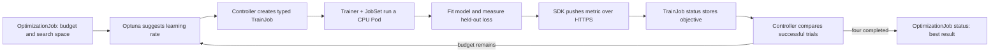

# A real OptimizationJob demo

The baseline result was a tested development starting point: pinned upstream code, a Git repository and repeatable tests. This demo adds a real local Kubernetes run so you can see the optimization loop working.

## What is demonstrated

An actual `trainer.kubeflow.org/v1alpha1` OptimizationJob requests four trials, one at a time. The upstream controller starts an Optuna Random-search service, asks it for a learning rate, creates a TrainJob, and lets Trainer/JobSet run a CPU training Pod. That Pod fits a linear regression model, computes validation mean squared error, and pushes the metric through the Kubeflow SDK's authenticated HTTPS status endpoint. The controller records the successful trial with the smallest loss.

The model predicts `weight*x + bias` for synthetic data generated from `2*x + 1 + noise`. It starts from zero weights and trains for 40 gradient-descent epochs on 64 examples, then evaluates on 64 held-out examples. The measured objective is not a hardcoded score. A fixed dataset seed and identical initial weights make learning-rate comparisons meaningful.

Random search can sample the same configuration more than once. In the first real run, rates were 0.02, 0.1, 0.1 and 0.005. Their final losses were approximately 0.39281249, 0.00731701, 0.00731701 and 1.26634172. The controller selected the earlier of the two tied best trials. The report independently checks the winner and matches each status metric to its successful Pod's training log and delivery acknowledgment.



## Run it

Prerequisites are the pinned sibling checkouts from `upstream.lock.json`, the existing WSL Ubuntu-22.04 distro, Go compatible with Trainer's 1.27 directive, Docker, kind, kubectl, Bash and Python 3. No global package installation is performed by the launcher. Docker/registry/network access and several GB of free disk/RAM are required.

From PowerShell:

```powershell
wsl -d Ubuntu-22.04 -- bash /mnt/h/GSocProjects/optimizationjob/demo/start.sh
```

It creates/reuses only `optimizationjob-demo`, uses a separate kubeconfig under the ignored `.tools/demo` directory, builds the pinned upstream controller and a small CPU training image, installs the upstream manifests, submits a uniquely named job, waits and produces a checked report. It refuses mismatched/dirty upstream checkouts. It does not change the current user kubeconfig or deploy to an existing unrelated context.

To submit another job against the already running demo, without rebuilding images:

```powershell
wsl -d Ubuntu-22.04 -- python3 /mnt/h/GSocProjects/optimizationjob/demo/run.py
```

To inspect the original completed run:

```powershell
wsl -d Ubuntu-22.04 -- python3 /mnt/h/GSocProjects/optimizationjob/demo/run.py --existing learning-rate-demo
```

Reports and logs are saved outside Git at `H:\GSocProjects\optimizationjob-evidence\runs\demo\reports`. `index.html` is a self-contained saved walkthrough with interactive learning curves and real results. It is not a live cluster dashboard.

To serve it locally, from PowerShell:

```powershell
& H:\GSocProjects\optimizationjob\.venv\Scripts\python.exe -m http.server 8765 --bind 127.0.0.1 --directory H:\GSocProjects\optimizationjob-evidence\runs\demo\reports
```

Open [the walkthrough](http://127.0.0.1:8765). Only the report directory is served; private kubeconfig credentials are elsewhere.

## Inspect the actual resources

Open a WSL terminal and keep it open while exploring; this older WSL installation can shut down between detached host commands. A foreground keepalive was used during the demonstration. If the distro/daemon stopped, check the dedicated node rather than assuming the report proves it is still running.

```bash
export KUBECONFIG=/mnt/h/GSocProjects/optimizationjob/.tools/demo/kubeconfig
kubectl --context kind-optimizationjob-demo get nodes
kubectl --context kind-optimizationjob-demo -n optimizationjob-demo get optimizationjobs,trainjobs,pods
kubectl --context kind-optimizationjob-demo -n optimizationjob-demo get optimizationjob learning-rate-demo -o yaml
```

Select an actual Pod name from that output to inspect worker logs with `kubectl logs -n optimizationjob-demo POD_NAME -c node`. `report.json`, `optimizationjob.json`, `trainjobs.json` and per-trial logs contain the saved proof.

## Local compatibility fixes

- The WSL Docker daemon uses cgroup v1. The demo's kind config sets `failCgroupV1: false` only in its kubelet configuration, the [documented temporary Kubernetes override](https://kubernetes.io/docs/concepts/architecture/cgroups/). It does not reconfigure the host. This is for a local compatibility demo, not the preferred production setup.
- The node image is pinned to the cached Kubernetes 1.37 digest. Kind's generic all-platform image import failed against Docker's partial OCI indexes; the launcher exports only linux/amd64 before import.
- Controller startup includes certificate generation/projection before status-server readiness. The demo adds a startup probe to avoid premature liveness restarts while certificates become available.
- The training workload runs nonroot, without privilege escalation, with a read-only root filesystem and bounded resources. A namespace network-policy manifest permits same-namespace/provider traffic; kind's default CNI does not enforce NetworkPolicy, so this is not claimed as tested network isolation. The upstream suggestion service still uses insecure internal gRPC; keep this cluster local/trusted.

## Boundaries

This is real Kubernetes orchestration, model fitting and SDK push reporting using existing upstream components. It does **not** demonstrate GPU training, shared artifact initialization, controller/provider crash recovery, Grid search, or a new OptimizerClient submission backend. The current SDK still submits Experiments, so this demo deliberately submits the typed CRD using kubectl. The dataset is regenerated deterministically per trial; no shared initializer is being implied.

It is an educational, runnable integration demo. It does not claim that a complete four-trial run proves all the planned controller safety and production requirements. No upstream product source was modified to make this run work.

## Tests and cleanup

```bash
cd /mnt/h/GSocProjects/optimizationjob/demo
python3 -m unittest discover -s tests -p '*_test.py' -v
```

The tests cover actual model learning/reproducibility and reporting's refusal of incomplete/nonfinite/wrong-winner results. The real cluster run supplies the integration evidence.

Reproducibility boundary: upstream source revisions, the node digest and provider digest are pinned. The Python and distroless base images still use tags, and transitive Python dependencies are resolved when the training image is built. The executed image identities and resolved package versions are saved in external evidence; an exact uncached rebuild is not yet guaranteed. Pinning all base/dependency digests is a follow-up, not a claim of this demo.

After inspecting the demo, this command removes **only its explicitly named disposable cluster**:

```powershell
wsl -d Ubuntu-22.04 -- kind delete cluster --name optimizationjob-demo
```

It leaves source repositories and saved evidence intact. The demo cluster is left available for inspection after completion; cleanup is not run automatically.
